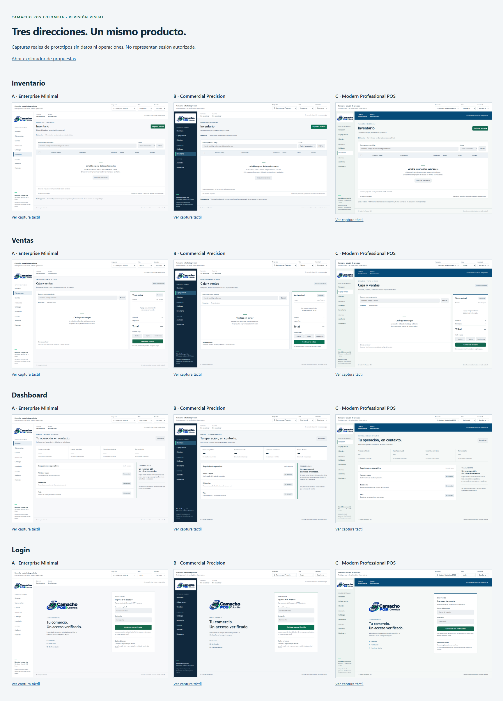

# Camacho POS Colombia — tres direcciones visuales

**Corte histórico de propuestas. B fue aprobada posteriormente por el propietario
mediante «Apruebo B»; [implementación y evidencia del 2026-10-25](../../testing/commercial-precision-2026-10-25.md).** Base del estudio
`781328ef0ba3c6346d1ac297ad9f475b8eb9cf34`, rama activa
`feat/android-commercial-runtime`, PR #96 draft. Local/remoto coincidían; sólo
`docs/product/oracleJdk-27/` concurrente, preservado. No se accedió a
`.claude-desactivado` ni respaldos externos. La nueva orden autoriza este estudio
acotado; no reemplaza el trabajo de seguridad ni autoriza otro runtime.

Abrir [comparación de las tres propuestas](comparison.html) o el
[explorador interactivo](index.html). Navegación del explorador = cambio de
composición visual; **no** concede sesión o permisos. Campos de autenticación y
acciones comerciales deshabilitados. Sin backend, bridge, almacenamiento,
credenciales, registros inventados o nuevas pantallas productivas.



## Instalación y verificación

Instalador oficial local `C:/Users/Usuario/.codex/skills/.system/skill-installer/`.
Repositorios revisados en directorio temporal, refs fijadas a SHA antes de instalar.
Sin instaladores comunitarios, npm/pip, paquetes productivos ni cambios a
`.agents/skills`. Las licencias comunitarias originales se conservaron también
en cada directorio personal. [Manifest de procedencia y archivos](skill-installation.json).

| Skill / invocación | Origen y commit exacto | Ubicación personal | Estado observado |
| --- | --- | --- | --- |
| `$frontend-design` | [dobromirdikov/codex-frontend-design-skill](https://github.com/dobromirdikov/codex-frontend-design-skill), `983119775a936d123df9fbfbc3821bdee5bb58fd`, `skills/frontend-design`, Apache-2.0 | `C:/Users/Usuario/.codex/skills/frontend-design` | Instalada; 2 archivos originales contrastados byte a byte; instrucciones/metadata leídas y usadas para composición y QA |
| `$ui-ux-pro-max` | [Rpeng666/ui-ux-pro-max-skill-codex](https://github.com/Rpeng666/ui-ux-pro-max-skill-codex), `5c02e4c57e8dce4451f65c0dd50eab6b4a4ed3e6`, `.claude/skills/ui-ux-pro-max`, MIT | `C:/Users/Usuario/.codex/skills/ui-ux-pro-max` | Instalada; 33 archivos verificados; buscador UX/product ejecutado correctamente |
| `$security-best-practices` | [openai/skills](https://github.com/openai/skills), `49f948faa9258a0c61caceaf225e179651397431`, `skills/.curated/security-best-practices`, Apache-2.0 | `C:/Users/Usuario/.codex/skills/security-best-practices` | Instalada; 13 archivos verificados, guía frontend consultada para el prototipo |
| `$security-threat-model` | [openai/skills](https://github.com/openai/skills), mismo SHA, `skills/.curated/security-threat-model`, Apache-2.0 | `C:/Users/Usuario/.codex/skills/security-threat-model` | Instalada; 5 archivos verificados, frontmatter/referencias disponibles. No se ejecutó un modelo completo ni auditoría general |
| Codex Security | [Plugin oficial](https://openai.com/business/plugins/codex-security/) | Gestionado por la aplicación, no una carpeta skill | Disponible, instalación **no confirmada**. Se inició el procedimiento de instalación en la aplicación. GitHub opcional ya conectado; Linear/Atlassian opcionales no se instalaron. Sin escaneo ejecutado |

El catálogo automático de Codex se refresca en el siguiente turno. No se afirma
que estuvieran incluidas en el catálogo inicial de esta sesión: se leyeron por su
ruta instalada. Frontmatter válido y contenido idéntico al SHA fijado comprobados.
Para las skills declarativas la invocación es el nombre `$…` anterior; no tienen
CLI ni requieren instalar dependencias. UI/UX sólo usa Python estándar y CSV
local. La ruta `dist/SKILL.md` del repositorio comunitario no traía scripts/datos;
se eligió la carpeta completa, no un paquete incompleto ni todo su ecosistema.

Comprobación ejecutada:

```powershell
python C:/Users/Usuario/.codex/skills/ui-ux-pro-max/scripts/search.py 'data table keyboard touch contrast' --domain ux -n 3
python C:/Users/Usuario/.codex/skills/ui-ux-pro-max/scripts/search.py 'enterprise POS dense inventory operations' --domain product -n 2
```

Se revisaron SKILL.md, imports y acceso a archivos de search/core/design_system;
sin red/subprocesos/eval en la ruta ejecutada. La opción de persistir puede escribir
documentos, por lo que no se ejecutó `--persist`. Los resultados UX respaldan
contraste, teclado, tablas con scroll acotado y densidad operativa; no sustituyen
el criterio de producto ni introducen las animaciones/librerías sugeridas por
otros estilos de la base comunitaria.

## Inventario del frontend existente

Inspección limitada a renderer, formulario HTTPS y sus hooks/estilos. Las rutas
son selección interna en App.tsx, no URLs que deban inventarse. `hasAny` con
permisos vacíos devuelve false: varias definiciones planificadas no son menús
alcanzables; su existencia en un array no equivale a producto implementado.

| Área requerida | Owner / ruta actual | Estado de la superficie |
| --- | --- | --- |
| Login / acceso | `apps/central-authority/src/commercial-browser-entry.ts`; `apps/pos-desktop/renderer/src/App.tsx` | Formulario HTTPS y ceremonia de laboratorio existentes; estados locales reales. Provisión/login humano siguen pendientes. Rediseño de dos superficies, no captura de contraseña en React |
| Dashboard | `components/AdministrativeControlPanel.tsx`, `hooks/useAdminMetrics.ts` | Parcial: métricas reales de ventas/stock/turnos según permiso; no analítica completa |
| Ventas / punto de cobro | `components/SalePanel.tsx`, `hooks/useCommercialSale.ts` | Implementada dentro del alcance actual: catálogo, carrito, operación, pagos existentes. Este estudio no la vuelve a probar ni amplía medios |
| Catálogo | `components/CatalogPanel.tsx` | Consulta como lista, alta y preview/confirmación CSV implementadas. No importación binaria XLSX/PDF ni stock por CSV |
| Inventario | `components/InventoryPanel.tsx` | Parcial: entrada, ajuste y consulta por presentación. No tabla masiva de existencias ni endpoint de listado materializado en esta vista |
| Clientes / proveedores | `components/CustomerPanel.tsx` | Clientes/adquiriente y privacidad implementados en su alcance. Sin pantalla de proveedores equivalente encontrada en el renderer inspeccionado |
| Caja / apertura / cierre / arqueo | `components/SalePanel.tsx` | Apertura/cierre dentro de ventas; no superficie autónoma de arqueo/cierre ciego que se pueda declarar terminada |
| Compras / movimientos | Inventario registra entrada/ajuste | Sin pantalla de compras integral; no crear un PurchaseOrder ficticio como parte del diseño |
| Sucursales / traslados | `plannedScreens` en App.tsx | Sucursales es definición planificada con permisos vacíos; no alcanzable. Sin vista de traslados real encontrada |
| Reportes / analítica | `plannedScreens`, métricas administrativas | Reportes planificado/no alcanzable; métricas parciales no equivalen a reportes/exportación |
| Configuración comercial | `plannedScreens` | Configuración/empresa/dispositivos planificados con permisos vacíos; no CRUD conectado |
| Administración / superadmin | `AdministrativeControlPanel.tsx`, `plannedScreens` | Administración y auditoría parciales; superadmin tiene composición/cifras sin fuente y su registro con permisos vacíos no es acceso productivo |
| Hardware / impresión | `HardwarePanel.tsx`, `ReceiptPanel.tsx` | UI de consulta/comandos existentes bajo permisos; no nueva certificación física. CD350 sigue bloqueado por perfil eléctrico |
| Offline / sincronización | `StatusPanel.tsx`, `useRuntimeStatus.ts` | Estado de conexión al Service; no panel completo de cola/outbox/sincronización. Servicio local conectado no significa Internet o sync correctos |
| Error / carga / denegación | App.tsx, `useAuthorizationCapabilities.ts`, errores por panel | Estados existentes derivados del backend. No convertir un toggle de diseño en estado de autenticación |

Las rutas de componentes/hooks anteriores son relativas a
`apps/pos-desktop/renderer/src/`. Otras superficies como FiscalPanel, ReceiptPanel
y OperationPanel se conservan y se incluyen en el plan; no se rediseña FACTUS.

## Problemas visuales demostrables

1. **Marca oscura sobre acceso oscuro:** captura del renderer existente
   [sin Service](captures/current-renderer-disconnected.png) y CSS `.pos-entry` /
   `.pos-entry-brand`; parte del wordmark pierde legibilidad. Mantener el PNG
   aprobado sobre soporte claro, sin recolorearlo o crear otro logo.
2. **Acceso fragmentado:** formulario HTTPS con CSS propio (`commercial-browser-entry.ts`)
   frente a tokens/estilos de App.css. Unificar dirección visual tras aprobar,
   manteniendo ambos contextos y sus controles de seguridad separados.
3. **Inventario y catálogo tienen distinta densidad/formato:** consulta puntual
   en InventoryPanel frente a `<ul>` de resultados con IDs/precio en CatalogPanel.
   La tabla propuesta exige primero resolver qué datos permite cada contrato;
   no se presenta el listado nuevo como ya implementado.
4. **Administración repite tarjetas:** `AdministrativeControlPanel.tsx` overview
   y monitoring, `.pos-admin-grid` / `.pos-admin-card` en App.css. Sustituir repetición
   por banda de indicadores puntuales y seguimiento por filas; no inventar métricas.
5. **Tabla de auditoría construida con divs:** roles table/row con spans sin
   celdas semánticas completas en AdministrativeControlPanel. Proponer `<table>`
   con caption/th/scope y scroll por región; no declarar auditoría accesible completa.
6. **Jerarquía de tareas en ventas:** SalePanel reúne apertura/cierre, catálogo,
   lector, carrito y cobro. Separar visualmente turno, búsqueda y confirmación sin
   reconstruir sus estados o permisos. El touch grid existente no se sustituye
   automáticamente por una tabla; selección de producto y gestión de stock son tareas distintas.
7. **Acciones técnicas/estados extensos:** mensajes como LOCAL_SERVICE_UNAVAILABLE
   visibles en acceso; conservar causa para diagnóstico y priorizar una instrucción
   operativa legible. El prototipo muestra redacción propuesta, sin cambiar códigos.

Sólo el estado desconectado del renderer se observó en ejecución actual. Las
pantallas protegidas anteriores se revisaron en código; no se inyectaron grants
para generar capturas de ellas. No se atribuye esta sesión a una prueba humana.

## Tres propuestas comparables

| Dirección | Paleta HEX | Tipografía offline propuesta | Composición / consecuencia |
| --- | --- | --- | --- |
| **A · Enterprise Minimal** | Azul `#174A74`, verde `#176A4C`, texto `#172D3B`, secundario `#536471`, fondo `#F7F8FA`, borde `#DCE2E7` | Segoe UI → system-ui; 14 px escritorio, 16 táctil | Sidebar clara 200 px, líneas finas, radios 2 px, encabezados compactos. Menor peso visual, útil para tareas administrativas largas |
| **B · Commercial Precision — recomendada** | Azul `#123D68`, verde `#087052`, texto `#142B3A`, secundario `#536475`, fondo `#F3F6F8`, nav `#10283D`, borde `#D6DFE6` | Bahnschrift → Segoe UI → system-ui; 15 px escritorio, 16 táctil | Navegación oscura 218 px con logo en soporte claro, jerarquía estable y cobro diferenciado. Buen equilibrio operativo entre escritorio y AIO; revisar Bahnschrift con operadores antes de fijar la fuente |
| **C · Modern Professional POS** | Azul `#064B78`, verde `#136750`, texto `#163145`, secundario `#526572`, fondo `#F5F8F7`, nav `#EDF3F1`, borde `#D6E1DF` | Trebuchet MS → Segoe UI → system-ui; 15 px escritorio, 16 táctil | Banda de contexto azul, sidebar clara 174 px, títulos abiertos y radios 7 px. Mayor presencia de marca; ocupa más altura que A |

Fuentes de plataforma, sin CDN ni downloads. Los fallbacks pueden variar en
Android/Linux; no se certificó la disponibilidad tipográfica física en ellos.
Si se decide una fuente universal se deberán revisar licencia, empaquetado y
renderizado antes de añadir un asset. No se cambian dependencias por este estudio.

Cada dirección incluye login, dashboard, inventario, ventas, navegación, botones,
estados, catálogo/clientes/caja/auditoría/hardware y hoja visual de componentes.
No son nuevos módulos ejecutables. Inventario/listado muestra campos propuestos
sin filas; no hay productos, importes, usuarios o permisos artificiales. Costo/precio
de inventario no se exponen hasta definir autorización/fuente específicas.

**Recomiendo B**, porque diferencia navegación y área de trabajo, mantiene el
total visible y reserva el verde para confirmación/acción. No depende de tarjetas
KPI como estructura completa. A es preferible si se prioriza máxima sobriedad y
densidad; C si se quiere una marca más presente. La elección visual no aprueba
funciones, contratos o políticas de acceso.

## Tablas, interacción y adaptación

- Tabla nativa, encabezados/caption y cifras tabulares/alineadas. La vista estrecha
  permite scroll **dentro de la tabla**, no de todo el documento. Mantener columnas
  operativas; no convertir registros en tarjetas. Fijación de columnas requiere
  validar lectores de pantalla y presupuesto de renderizado en la implementación.
- Búsqueda/filtros/ordenación/selección/acciones están dibujados, pero inactivos.
  No se simula funcionalidad sobre registros inventados. Catálogo conserva su
  paginación real; stock listado requiere contrato antes de conectarlo. No elegir
  virtualización sin volumen medido ni añadir un paquete de tablas por estética.
- Windows: densidad 36 px por control, foco visible, navegación estable. Atajos
  se diseñarán sobre la interacción existente y comprobarán colisiones, no se
  prometen teclas F para funciones que todavía no están conectadas.
- AIO: densidad de 48 px, separación y labels; reordenación de búsqueda/carrito,
  sin gestos exclusivos o hover como única señal. El teclado numérico propuesto
  usa inputmode cuando corresponda; su aparición/ocultación real en Android no
  se certificó. No se conecta el prototipo a CPC Android v0.12 o hardware.
- Linux: mismo CSS y fallback; no se ejecutó un runtime Linux físico. Responsive
  no prueba interoperabilidad ni compatibilidad de un puente nativo.
- Estados funcionales usan texto además de color; tablas/formularios/errores
  mantienen labels y foco. No animaciones decorativas, gráficos sin fuente,
  gradientes, glassmorphism, iconos de relleno ni librerías nuevas.

## Seguridad del alcance modificado

Revisión preventiva limitada de frontend/prototipos, no pentest ni modelo de
amenazas completo. No se atribuye un escaneo al plugin pendiente. `$security-threat-model`
está preparado para una revisión formal posterior con contexto confirmado.

| Frontera | Evidencia existente / preservada | Regla para la futura implementación |
| --- | --- | --- |
| UI → autoridad | `useAuthorizationCapabilities.ts` valida respuestas y recarga capacidades tras recuperar sesión | Visibilidad nunca sustituye permiso del backend; no inferir rol/tenant de un selector o dato persistido en React |
| Renderer → main | `pos-service.ts` consume `window.posService`; allowlist/preload existentes | No modificar IPC, exponer firma o entregar tokens/claves por razones de diseño |
| Navegador HTTPS → BUSINESS | `commercial-browser-entry.ts` conserva CSP/nonce, CSRF, MFA y confirmación | Cambiar sólo presentación tras aprobación; la propuesta de login no ejecuta ceremonia ni acepta contraseñas |
| Datos → DOM | Propuestas con templates estáticos y cloneNode/textContent; parámetros en allowlists | Sin innerHTML, eval, enlaces construidos desde entradas libres o scripts remotos |
| Estudio → runtime/hardware | Documentos independientes, CSP connect-src none, acciones/inputs deshabilitados; servidor QA GET/loopback sobre tres directorios públicos acotados | No conectar a DB/API ni instalar bridges para que una captura parezca un POS funcionando |

No se modificaron autenticación, contraseña/MFA, PKCE, SSA/SAS, DeviceTrust,
RBAC, RLS, pagos, inventario, facturación, outbox, contratos o archivos runtime.
La revisión no demuestra ausencia global de vulnerabilidades.

## Pruebas y límites reales

Ejecutado `node tools/design/render-pos-proposals.mjs` con Playwright ya instalado
y Edge headless existente; servidor GET temporal loopback y perfil de navegador
de prueba, cerrados al finalizar. No instalación de navegador ni dependencia.

- **132 layouts**: 3 propuestas × 11 vistas × anchos 1440/1024/768/390.
- **24 capturas**: inventario/ventas/dashboard/login × 3 × escritorio 1440×1000
  y táctil lógico 1024×768; galería comparativa y renderer actual adicional.
- Cero errores JS/console finales, cero peticiones fetch/XHR/WebSocket del
  prototipo, imágenes cargadas y sin overflow horizontal del documento.
- Campos/acciones comerciales inactivos en todas las vistas; query inválida
  vuelve al tema/vista cerrados y enlace de salto recibe foco con teclado.
- Apertura directa `file://` del explorador comprobada con Edge: scripts/estilos
  locales cargan y la vista Inventario aparece, sin necesidad de un servidor.
- **12 contrastes principales ≥ 4.5:1**; resultados exactos en
  [visual-checks.json](visual-checks.json). Blanco/verde: A 6.56, B 6.09, C 6.81.
  No es un audit completo WCAG ni cubre todos los pares/estados o lector de pantalla.
- Inspección visual de capturas A/B/C comparativas, inventario B, venta C táctil,
  login B táctil y renderer actual. Captura actual con animaciones finalizadas;
  no se inyectan bridge, sesión o permisos.
- Inicialmente faltó el Chromium headless de la versión Playwright; se usó Edge
  instalado. Primera pasada encontró favicon 404, corregido con el PNG aprobado.
  Una verificación de procedencia usó el TMP elegido por Python distinto al TEMP
  PowerShell; se corrigió la ruta de revisión y se verificaron 53 archivos originales.

No se repitieron suites de autenticación/comercio ni TypeScript/build del runtime:
ninguno de esos archivos cambió. El bundle existente sólo se observó desconectado.
Se ejecutaron comprobación de sintaxis de los scripts, fronteras arquitectónicas,
política (1064 archivos rastreados) y diff-check sobre el incremento documental. CI remoto continúa pendiente
por suspensión informada; no se declara verde.

## Implementación posterior, sólo tras aprobación visual

| Paso | Reutilizar / modificar | Gate antes de publicar UI funcional |
| --- | --- | --- |
| 1. Tokens y fundamentos | App.css y logo aprobado, sin reemplazar todo el archivo; tokens semánticos/densidades/foco/labels | Selección visual explícita; contraste, zoom/teclado y screenshots |
| 2. Shell y estados | App.tsx, StatusPanel, capacidades existentes | Conservación de denegación, expiración, scopes y menú según backend |
| 3. Login | Presentación HTTPS y acceso local existentes; sin mover credenciales a React | Ceremonia y callback existentes sin regresión; diseño no resuelve provisión |
| 4. Catálogo/clientes/auditoría | Paneles/hooks/contratos existentes, componentes de tabla/formulario sólo donde se repitan | Datos reales, privacidad, paginación/errores/denegaciones y selección por teclado |
| 5. Caja/ventas/recibo/fiscal | SalePanel y estados actuales, confirmación/pagos existentes | No pérdida de idempotencia, totales exactos ni confirmación de pago; E2E focalizado |
| 6. Inventario | Formularios/consulta existentes; tabla sólo cuando exista listado autorizado | Contrato/volumen/permisos antes de filtros, costos o virtualización; no inventario ficticio |
| 7. Administración/hardware/offline | Métricas y consultas ya alcanzables; estados reales | Sin funciones vacías mostradas como terminadas, sin pulsos; pruebas de canal/roles afectadas |
| 8. Pendientes del producto | Compras/proveedores/traslados/reportes/config/superadmin | Primero owner/contratos/permisos y misión funcional propia. El sistema visual no autoriza implementarlos |

Cada paso tendrá su diff visual independiente y validaciones funcionales
focalizadas, TypeScript/build cuando toque código de producto, arquitectura y
política. Sin merge a main por aprobar una propuesta. No iniciar paso 1 sin
elección A/B/C o ajustes solicitados por el propietario.
